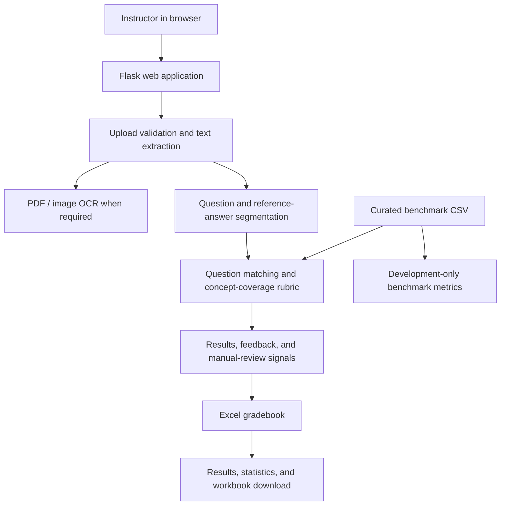

# Answer Sheet Evaluator Using NLP

A Flask web application that extracts text from answer sheets, aligns numbered
student answers with a reference answer key, awards concept-coverage-based
marks, and stores results in an Excel gradebook. It also includes a small,
editorially labelled benchmark for development diagnostics.

> **Project/report guidance:** This README describes the implementation in
> this repository. Benchmark results are development diagnostics, not evidence
> of teacher-verified or real-world grading accuracy. Do not present them as
> such in a project report.

## Contents

- [Project overview](#project-overview)
- [Objectives and scope](#objectives-and-scope)
- [Features](#features)
- [System architecture](#system-architecture)
- [Evaluation process](#evaluation-process)
- [Benchmark and reported metrics](#benchmark-and-reported-metrics)
- [Technology stack](#technology-stack)
- [Project structure](#project-structure)
- [Installation and setup](#installation-and-setup)
- [Running the application](#running-the-application)
- [Using the application](#using-the-application)
- [HTTP routes](#http-routes)
- [Testing](#testing)
- [Limitations and responsible use](#limitations-and-responsible-use)
- [Project-report outline](#project-report-outline)
- [Screenshots](#screenshots)

## Project overview

Manual answer-sheet grading can take time, especially when an instructor must
review many students' answers to the same set of questions. This project
provides a local web workflow to extract text from supported documents, compare
each student's response with a reference answer, calculate marks using
normalized concepts, and retain the results in a subject-specific Excel
workbook.

The default grading method is a deterministic lexical concept-coverage rubric.
It does not use a remotely hosted language model. An optional, locally cached
Sentence Transformer can provide a semantic similarity signal to recommend
manual review, but it does **not** alter the marks awarded.

The application is intended to assist review and automate consistent,
transparent calculations. An instructor remains responsible for checking
extraction errors, question alignment, rubric suitability, and final grades.

## Objectives and scope

### Objectives

1. Accept answer keys and student answer sheets in common document formats.
2. Extract readable text and separate answers using question labels.
3. Compare student answers with their corresponding reference answers.
4. Show marks, concept coverage, missing or contradicted concepts, and
   explanatory feedback.
5. Support single-student and batch workflows.
6. Store results in an Excel workbook and provide result/statistics pages.
7. Provide a small repeatable benchmark for development checks.

### Scope

- The rubric awards marks from reference-concept coverage; it is not a
  general-purpose natural-language understanding or human-equivalence system.
- Question alignment is based on normalized labels and then question number.
- Benchmark metrics compare simple pass/review predictions with editorial
  labels. They do not assess the numeric marks given to real student work.
- The application stores gradebook data locally in Excel; it does not provide
  accounts, roles, a database-backed multi-user gradebook, or a deployment
  security model.

## Features

- **File extraction:** PDF, PNG, JPG/JPEG, DOCX, TXT, XLSX, and XLS input.
- **Scanned-document support:** Tesseract OCR for image files and PDF pages
  without selectable text.
- **Question segmentation:** Recognizes common labels such as `Q1.`, `Question
  1:`, `1)`, `Q2(a)`, and labels on their own line.
- **Text review:** Preview and correct extracted key/student text before
  evaluation.
- **Single evaluation:** Grade one student against a reference answer key.
- **Batch evaluation:** Grade multiple student sheets against a shared key.
- **Concept-level feedback:** Lists covered, missing, and contradicted concepts
  and explains the calculated score.
- **Optional semantic review:** Uses a locally cached `all-MiniLM-L6-v2` model
  as an additional review signal only.
- **Excel gradebook:** Appends results to a worksheet for each subject.
- **Results and statistics pages:** Browse saved grades, download the workbook,
  and inspect benchmark examples and development metrics.
- **Upload safeguards:** Extension and content-signature checks, secure upload
  filenames, temporary upload cleanup, and a 32 MB request-size limit.

## System architecture



### Main components

| Component | Responsibility |
| --- | --- |
| `app.py` | Flask routes, request validation, upload orchestration, evaluation flow, and page/API responses. |
| `modules/extractor.py` | File validation and PDF, image, DOCX, TXT, and spreadsheet text extraction. |
| `modules/parser.py` | Cleans extracted content and separates numbered student/reference answers. |
| `modules/evaluator.py` | Matches question labels and coordinates scoring for one or more answers. |
| `modules/local_rubric.py` | Normalizes concepts, calculates coverage and marks, detects selected negations, and creates feedback/review signals. |
| `modules/storage.py` | Creates and updates subject worksheets in the Excel gradebook. |
| `modules/evaluation_statistics.py` | Loads the benchmark and summarizes benchmark or saved gradebook data. |
| `templates/` | Browser pages for evaluation, saved results, and statistics. |
| `data/answer_benchmark.csv` | Development/test cases with labels, split, and provenance. |

## Evaluation process

### 1. Input validation and text extraction

The application checks the file extension and, for supported binary formats,
validates its content signature. It saves uploads under unique secure names,
then routes them to the relevant extractor:

- PDFs use `pdfplumber` for selectable text. Pages without text use OCR.
- Images are preprocessed with Pillow and read with Tesseract OCR.
- DOCX paragraphs and table cells are read with `python-docx`.
- TXT files are read as UTF-8 with a Latin-1 fallback.
- Spreadsheet cell values are read across workbook sheets.

The interface can preview the extraction so an instructor can correct
recognition or formatting mistakes before grading. Temporary uploaded files
are removed after the request.

### 2. Question segmentation and alignment

The parser normalizes line endings, removes known page/footer noise, and
recognizes common numbered-question formats. Reference answer sections that
look like rubrics or marking schemes are excluded from the model answer where
possible.

The evaluator first matches normalized question labels, including subparts,
and then uses a question number as a fallback. A missing student answer receives
zero for that item; a missing reference answer is surfaced for manual review.

### 3. Concept normalization and coverage

The local rubric tokenizes each answer, removes common stop words, normalizes
selected inflections and aliases, and treats selected multi-word concepts as
units. It then compares distinct reference concepts with distinct student
concepts. Selected negated concepts are not counted as correctly covered when
the negation conflicts with the reference.

The core quantities are:

```text
coverage = covered reference concepts / distinct reference concepts
question marks = maximum marks for the question × coverage
overall percentage = total marks / total possible marks × 100
```

Marks are rounded to two decimal places. Repeating a word does not increase
credit. Extra text does not increase the coverage numerator. Selected
contradictions are reported and can trigger a manual-review recommendation.

### 4. Optional semantic review signal

When enabled, the application computes cosine similarity between local
Sentence Transformer embeddings. This signal can add a manual-review reason
when its pass/review classification disagrees substantially with concept
coverage. It is shown as a review aid; marks continue to be based on concept
coverage.

Semantic use is off by default. It requires the optional dependency and a
pre-cached model, and the benchmark is deliberately run without it for
reproducibility.

### 5. Result storage and review

Successful evaluations are appended to `results/results.xlsx`, with one
worksheet per subject. Rows contain student and registration identifiers,
question marks, total marks, and percentage. The Results page can display saved
records, and the workbook can be downloaded. The Statistics page presents
saved-grade summaries separately from benchmark data.

## Benchmark and reported metrics

The benchmark is defined in `data/answer_benchmark.csv` and has **132 cases**:

| Split | Cases | Topics |
| --- | ---: | --- |
| Development | 30 | Deep Learning |
| Held-out test | 102 | Artificial Intelligence, Natural Language Processing, Machine Learning, Compiler Design, and Computer Networks |

The dataset includes examples copied from bundled sample sheets and
editorially curated variants and negative examples. Labels are `acceptable`,
`partial`, or `incorrect`. For binary diagnostic metrics only, `acceptable` is
the positive class; `partial` and `incorrect` are grouped as review outcomes.

The development-set coverage threshold is **37.5%**. It was selected using the
development split and is used to make pass/review benchmark predictions. It
does not determine student marks. The application displays the four
development-split metrics as a visual chart:

| Development metric | Value |
| --- | ---: |
| Accuracy | 80.0% |
| Precision | 80.0% |
| Recall | 88.9% |
| F1 score | 84.2% |

Here, precision, recall, and F1 treat `acceptable` as the positive class.
Accuracy is the fraction of pass/review predictions matching the editorial
binary labels. The held-out test split is used to show cases and predictions;
binary metric summaries are intentionally not presented for it in the current
statistics page/API.

> **Important interpretation:** The benchmark labels have not been
> independently verified by teachers. The sample is small and shares a source
> collection. These values describe this benchmark and rubric only. They do not
> establish production accuracy, fairness, mark-level agreement, or
> performance on unseen real student answers.

For a defensible educational evaluation, gather a larger privacy-reviewed set
of real answers, have multiple independent graders label it, adjudicate
disagreements, document consent and provenance, and preserve a separate
untouched test set. Report human agreement and mark-level measures separately
from binary pass/review metrics.

## Technology stack

- **Language:** Python
- **Web framework:** Flask
- **UI:** HTML, CSS, JavaScript, and Jinja templates
- **Text processing:** Python regular expressions and a project-local concept
  normalization rubric
- **Document extraction:** `pdfplumber`, `python-docx`, `pandas`
- **OCR:** Pillow and `pytesseract`, backed by the Tesseract system executable
- **Excel:** `openpyxl`
- **Optional semantic signal:** `sentence-transformers` with a locally cached
  `all-MiniLM-L6-v2` model
- **Tests:** Python `unittest`

## Project structure

```text
.
├── app.py
├── modules/
│   ├── evaluation_statistics.py
│   ├── evaluator.py
│   ├── extractor.py
│   ├── local_rubric.py
│   ├── parser.py
│   └── storage.py
├── templates/
│   ├── index.html
│   ├── results.html
│   └── statistics.html
├── data/
│   ├── README.md
│   └── answer_benchmark.csv
├── output/
│   ├── benchmarks.png
│   ├── development-metrics.png
│   ├── evaluate-page.png
│   ├── evaluation-result.png
│   ├── results-page.png
│   ├── sample_reference_answer_key.pdf
│   └── sample_student_answers.pdf
├── results/
│   └── results.xlsx
├── requirements-semantic.txt
└── tests/
```

The `results/results.xlsx` workbook is runtime data; it is created or updated
when evaluations are saved. The screenshots and sample PDFs in `output/` are
supporting materials, not application inputs required at startup.

## Installation and setup

Use Python **3.9 or newer**. Run these commands from the directory containing
`app.py`.

### Windows PowerShell

```powershell
py -3 -m venv .venv
.\.venv\Scripts\Activate.ps1
python -m pip install --upgrade pip
python -m pip install Flask pdfplumber python-docx pandas openpyxl Pillow pytesseract
```

If PowerShell blocks environment activation, either adjust the current user's
script policy according to your organization's rules or invoke
`.venv\Scripts\python.exe` directly instead of activating the environment.

### macOS/Linux

```bash
python3 -m venv .venv
source .venv/bin/activate
python -m pip install --upgrade pip
python -m pip install Flask pdfplumber python-docx pandas openpyxl Pillow pytesseract
```

For legacy `.xls` workbooks, install the pandas Excel engine if it is not
already available:

```text
python -m pip install xlrd
```

### OCR setup

`pytesseract` is a Python wrapper and does not install the Tesseract executable
or language data. Install Tesseract OCR separately and ensure the English
`eng.traineddata` file is available. On Windows, the extractor checks the
common `C:\Program Files\Tesseract-OCR\` installation path and supports
`TESSDATA_PREFIX` for the tessdata directory. Scanned PDF and image extraction
requires this setup; text-based PDF and other supported formats can be used
without OCR.

### Optional semantic model setup

The default lexical evaluation does not require `sentence-transformers`.
To enable the optional semantic review signal:

1. Install the optional package:

   ```powershell
   python -m pip install -r requirements-semantic.txt
   ```

2. Cache the `sentence-transformers/all-MiniLM-L6-v2` model locally using
   your approved model-acquisition process.
3. Enable semantic review in the UI only after confirming the model is present
   in a cache path recognized by `modules/local_rubric.py`.

At runtime the application loads the model with local-only behavior; it does
not silently download the model. If semantic scoring is requested but its
dependency/model is unavailable, the application reports an error.

## Running the application

From the project directory with the virtual environment active:

```powershell
python app.py
```

Or, without activating the environment:

```powershell
.\.venv\Scripts\python.exe app.py
```

Open [http://127.0.0.1:5000](http://127.0.0.1:5000). The Flask development
server binds to localhost and is for development/demo use, not production
deployment.

## Using the application

1. Open **Evaluate**.
2. Select single or batch evaluation.
3. Enter the subject, maximum marks per question, and student details where
   required.
4. Upload a reference answer key and one or more student sheets.
5. Preview extraction and correct the text if necessary.
6. Run the evaluation and inspect totals, per-question marks, feedback, and
   manual-review recommendations.
7. Open **Results** to view saved records or download the Excel workbook.
8. Open **Statistics** to review saved gradebook summaries, benchmark cases,
   and development-split metrics.

Supported question numbering and file types are described in the
[Features](#features) section. Good results depend on readable documents,
consistent question labels, suitable reference answers, and human checking.

## HTTP routes

| Route | Method | Purpose |
| --- | --- | --- |
| `/` | GET | Render the evaluation form. |
| `/extract_for_review` | POST | Extract the uploaded reference/student text for review before grading. |
| `/evaluate` | POST | Evaluate and save a single student's answers. |
| `/evaluate_batch` | POST | Evaluate and save multiple student sheets against one key. |
| `/preview` | POST | Preview an uploaded document's extracted/segmented contents. |
| `/subjects` | GET | Return available saved subject names. |
| `/results` | GET | Render the saved-results viewer. |
| `/results/<subject>` | GET | Return saved rows for a subject as JSON. |
| `/download` | GET | Download the Excel gradebook. |
| `/statistics` | GET | Render saved-grade summaries and benchmark diagnostics. |
| `/statistics/data` | GET | Return benchmark cases/metrics and saved-grade summary as JSON. |

Evaluation routes accept multipart form data. The single route uses
`answer_key`, `student_answer`, `student_name`, `reg_number`, `subject`, and
`max_marks`; batch evaluation uses `answer_key`, multiple `student_answers`,
`subject`, and `max_marks`. The UI may instead submit reviewed text fields.
Uploads are limited to 32 MB per request.

## Testing

Run all tests from the project directory:

```powershell
python -m unittest discover -s tests -v
```

Or run the focused application, rubric, and benchmark tests:

```powershell
python -m unittest tests.test_app tests.test_local_rubric tests.test_statistics
```

The test suite covers question parsing and matching, concept scoring,
negation/review behavior, extraction and file validation, Excel persistence,
Flask routes, and benchmark split/metric calculations.

## Limitations and responsible use

- OCR can misread handwriting, low-quality scans, diagrams, mathematical
  notation, tables, and unusual layouts. Always review extracted text.
- Regex-based question segmentation works best with clearly numbered answers.
  Ambiguous or missing labels can cause answer alignment errors.
- Concept coverage rewards selected normalized reference concepts. It can miss
  valid paraphrases, context, reasoning quality, correctness of a claim, and
  domain-specific nuance; it can also match words in an incorrect context.
- The built-in rubric and benchmark are not substitutes for an instructor's
  marking scheme or judgment. Review borderline, contradictory, missing, and
  semantically disputed answers.
- The optional embedding score is a similarity signal, not a truth or
  correctness detector; it does not change the marks.
- Benchmark labels are editorial, small in number, and not teacher-validated.
  The development metrics must not be generalized to real classrooms.
- Student names and registration numbers are written to the local Excel
  workbook. Protect that file and any uploaded/source materials according to
  applicable privacy and retention requirements.
- The app has no authentication or authorization layer and runs with Flask's
  development server by default. Do not expose it to untrusted networks or use
  it as a production service without a separate security and deployment
  review.

## Project-report outline

The following outline can be used to prepare a report based on the actual
implementation:

1. **Abstract:** State the grading problem, the local web-based approach, key
   components, and the limits of the evaluation evidence.
2. **Introduction and problem statement:** Describe the workload and
   consistency problem, target users, and intended role as a grading aid.
3. **Objectives and scope:** Adapt the objectives/scope above; distinguish
   supported file processing from grading capabilities the system does not
   claim.
4. **Related work/background:** Research document OCR, keyword/concept-based
   assessment, text similarity, and human-in-the-loop grading. Cite sources
   you have independently consulted.
5. **Requirements and design:** Include functional/non-functional
   requirements, the architecture diagram, route table, data flow, and
   upload/privacy considerations.
6. **Implementation:** Explain extraction, parsing, question alignment,
   concept normalization, score calculation, review signals, and Excel
   persistence.
7. **Testing:** Summarize the unit/integration test command and explain what
   each test group verifies. Report the test run performed for the submitted
   code, not an assumed result.
8. **Evaluation:** Describe benchmark provenance, split sizes, labels,
   threshold selection, and the four development metrics. Explicitly state that
   labels are editorial and results are not real-world accuracy claims.
9. **Results and interface:** Use the screenshots below as interface
   illustrations; redact student identifiers before including any real
   records in a report.
10. **Limitations, ethics, and future work:** Cover OCR/alignment errors,
    benchmark quality, human review, privacy, security, and possible
    improvements such as independently labelled data and mark-level
    comparisons to graders.
11. **Conclusion and references:** Summarize what has been implemented, avoid
    overstating results, and cite external research/software appropriately.

## Screenshots

The `output/` folder includes screenshots that can be inserted into a project
report:

| Screenshot | Description |
| --- | --- |
| [Evaluation page](output/evaluate-page.png) | Upload form and application workflow. |
| [Sample evaluation result](output/evaluation-result.png) | Demonstration score and per-question results from bundled sample PDFs. |
| [Saved results](output/results-page.png) | Results table; student names and registration numbers are redacted. |
| [Development metrics](output/development-metrics.png) | Accuracy, precision, recall, and F1 chart for the development split. |
| [Benchmark cases](output/benchmarks.png) | Example benchmark labels, predictions, and answer text. |
